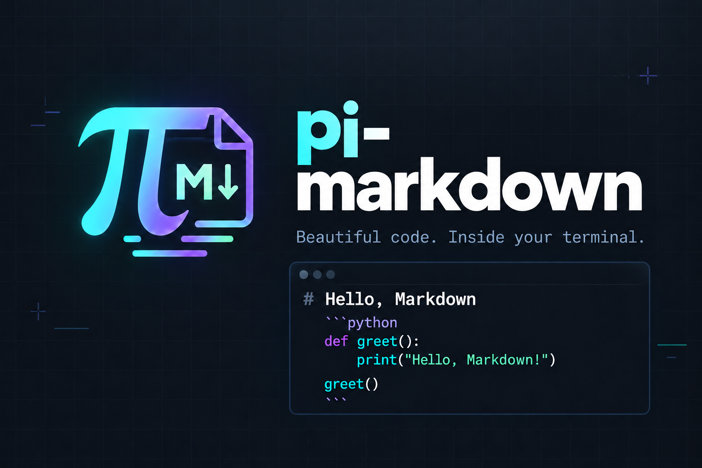
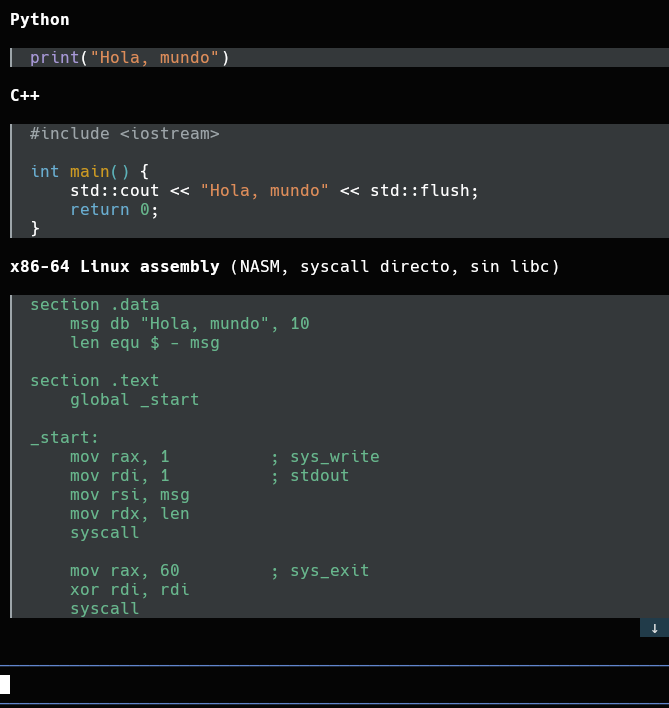

# 📝 pi-markdown



Elegant Markdown styling for Pi in your terminal—no browser required. Make code blocks easier to read with syntax highlighting, theme-aware backgrounds and three styles.

## Example of pi-markdown



## 🚀 Install via repo

```bash
pi install https://github.com/sul3chu/pi-markdown
```

Restart Pi after installing.

## 📦 Install cloning the repo

```bash
git clone https://github.com/sul3chu/pi-markdown.git
cd pi-markdown
pi install .
```

Keep the cloned folder in place: Pi loads the local package from there. Restart Pi after installing.

## 🎨 Usage

```text
/pi-md on
/pi-md off
/pi-md-style
```

Choose a style from the picker, or select one directly:

| Command | Style |
| --- | --- |
| `/pi-md-style simple` | Background and syntax colours, without borders. Best for copying. |
| `/pi-md-style panel` | A full frame with a language label. |
| `/pi-md-style rail` | A subtle vertical accent beside the code. |

Try `/markdown-style demo` to see an example. Bash snippets highlight commands, options and values in separate colours.

Settings last for the session. Pi starts with `simple`. Borders in `panel` and `rail` may be included when selecting text; use `simple` for easier copying.

## 🤝 How to contribute

1. Fork [sul3chu/pi-markdown](https://github.com/sul3chu/pi-markdown).
2. Clone your fork and create a branch:

   ```bash
   git clone https://github.com/YOUR_USERNAME/pi-markdown.git
   cd pi-markdown
   git switch -c improve-markdown
   ```

3. Make your changes and test them in Pi. Check narrow terminals, streaming responses and each style.
4. To run the automated tests, set `PI_TEST_AGENT` and `PI_TEST_TUI` to your installed Pi and pi-tui package directories, then run `npm test`.
5. Commit and push your branch:

   ```bash
   git add .
   git commit -m "Improve Markdown styling"
   git push -u origin improve-markdown
   ```

6. Open a pull request against `sul3chu/pi-markdown`. Explain the change and include screenshots for visual updates.

Bug reports and ideas are welcome through GitHub Issues! 🐛

## ⚙️ Compatibility

Tested with Pi **1.4.0**. This extension currently customizes an internal renderer API, so compatibility should be checked after Pi updates. It styles code blocks; the rest of Markdown uses Pi's existing renderer.

## 📜 License

Licensed under the **GNU General Public License v3.0**. See [LICENSE](LICENSE).


